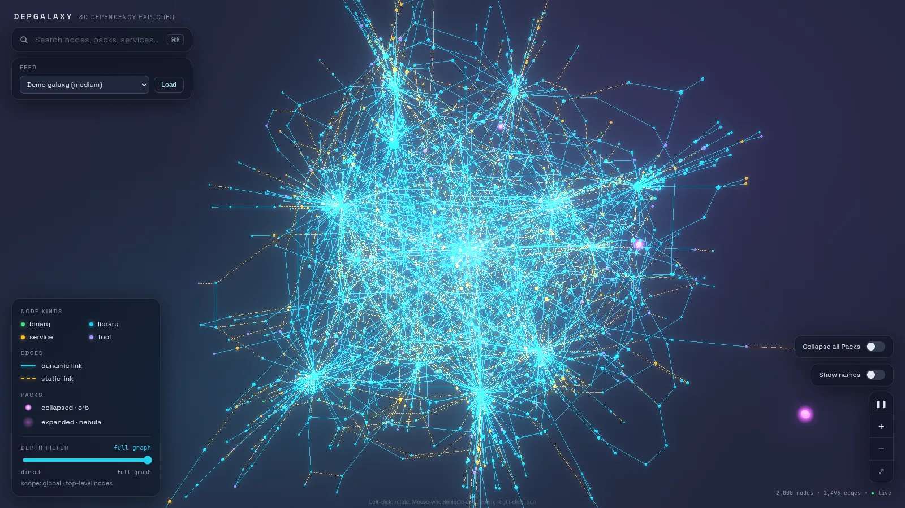
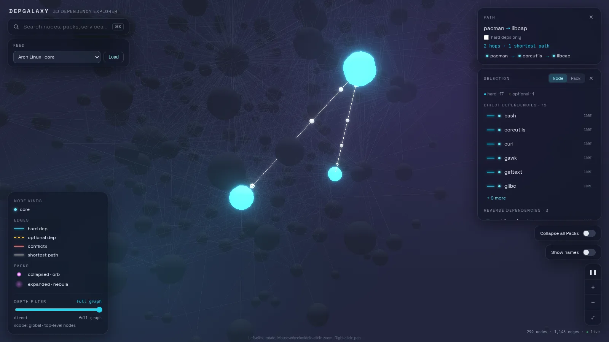

# Stellardeps

Explore arbitrary dependency graphs as an interactive 3D galaxy.

Nodes are stars colored by kind, dependencies are glowing links, and
groups of nodes ("packs") render as nebulae you can collapse into a
single orb. Load a demo galaxy, the dynamic libraries of a binary, or the
whole Arch Linux package graph, then search, filter by depth, isolate
subtrees, and find the shortest dependency paths between two nodes.





## Features

- **3D galaxy canvas** — force-directed layout (`react-force-graph-3d`)
  with bloom, auto-rotation, zoom/fit controls and optional node labels.
- **Packs** — collapse a pack to an orb or expand it to a nebula, one at a
  time or all at once.
- **Depth filter** — limit the view to N levels, rooted at the selected
  node, at an isolated subtree, or at the top-level nodes.
- **Search** — client-side autocomplete over node labels (`Ctrl-K` / `⌘K`).
- **Selection panel** — node or pack details: stats (members, edges in/out,
  dependents, deps, HOPS DEEP), edge-type breakdown, direct and reverse
  dependencies, conflicts, and collapse/isolate actions.
- **Path finder** — press **Path to…** on the selected node, then pick a
  destination with the search box or by clicking a node in the galaxy
  (`Esc` cancels). Every shortest dependency path lights up and the rest
  of the galaxy dims; the **Path** card lists the hops (click one to fly
  to it). If no path follows dependencies from source to destination, the
  reverse direction is tried. Packs work as endpoints, collapsed packs
  light up as orbs, and conflicts are never followed. When the galaxy
  has optional dependencies (pacman feeds), tick **hard deps only** to
  ignore them.
- **Typed links** — edges carry a `link_type` styled by the legend:
  `dynamic` / `static` (ldd), `hard` / `optional` / `conflicts` (pacman).
  Conflicts are displayed but never followed by depth slicing.
- **Feeds** — predefined graph sources launched from the UI (see below).

## Layout

- `backend/` — Python 3.12 + FastAPI + networkx. Stateless graph engine
  (collapse views, depth slicing) exposed over a small HTTP API, plus the
  feed builders (demo, `ldd`, pacman).
- `frontend/` — React + Vite + TypeScript, `react-force-graph-3d` canvas
  with a glassmorphic UI overlay, zustand store.
- `design/` — the original UI mockup, made with Claude Design and used as
  the visual target (`preview.webp`). The `.dc.html` source needs the
  Claude Design runtime, which is not included, to render.

## Quick start

Requires [uv](https://docs.astral.sh/uv/) and Node.js.

```bash
(cd backend && uv sync) && (cd frontend && npm install)
./start.sh
```

`start.sh` starts the backend on :8000, loads the demo galaxy if no graph
is loaded yet, and starts the frontend on http://localhost:5173. `Ctrl-C`
stops everything.

## Feeds

Pick a feed in the **Feed** panel and press **Load** to replace the
current galaxy. Feeds whose data source is missing on this machine are
listed as unavailable.

| Feed | Source | Needs |
|---|---|---|
| Demo galaxy (small / medium / large) | generated: 500 / 2000 / 5000 nodes | — |
| Arch Linux · core | pacman sync db, `%DEPENDS%` / `%OPTDEPENDS%` / `%CONFLICTS%` | `core.db` |
| Arch Linux · core + extra | same, both repositories | `core.db`, `extra.db` |
| Arch Linux · installed packages | local pacman db | `/var/lib/pacman/local` |
| ldd · /bin/ls, ldd · /usr/bin/python3 | shared libraries reported by `ldd` | `ldd`, the binary |

## API

The frontend proxies `/api/*` to the backend.

| Method & path | Purpose |
|---|---|
| `POST /import` | Replace the graph with a `GraphPayload` (`nodes`, `edges`, `containment`) |
| `GET /graph?collapsed=&depth=&root=` | Current view: collapsed packs (comma-separated), depth limit, slice root |
| `GET /node/{id}` | Details of one node or pack |
| `GET /path?from=&to=&collapsed=&exclude=` | All shortest dependency paths between two nodes or packs (count, up to 10 listed, highlights mapped onto the collapsed view); `exclude` lists link types not to follow, e.g. `optional` |
| `GET /feeds` | Registered feeds and their availability |
| `POST /feeds/{id}/run` | Build a feed and import it |

## Dev

Common tasks are in the `Makefile`:

| Command | What it does |
|---|---|
| `make dev-backend` | FastAPI dev server on :8000 (auto-reload) |
| `make dev-frontend` | Vite dev server on :5173, proxies `/api` to :8000 |
| `make seed` | Load the ~2000-node demo galaxy into the running backend |
| `make seed-ldd BIN=/usr/bin/curl` | Import the dynamic deps of a binary |
| `make test` | Backend format/lint/tests, frontend typecheck/tests |
| `make fmt` | Format and autofix the backend |

Backend tests use pytest; lint and formatting use ruff:

```bash
cd backend
uv run pytest
uv run ruff format . && uv run ruff check --fix .
```

Frontend tests use Vitest + Testing Library in jsdom. They cover the
API client, the store, the palette, and the UI panels. The 3D canvas
needs WebGL and is not unit-tested.

```bash
cd frontend
npm test            # vitest run
npm run typecheck   # tsc --noEmit
```

The default branch is `master`.

## License

MIT — see [LICENSE](LICENSE).
